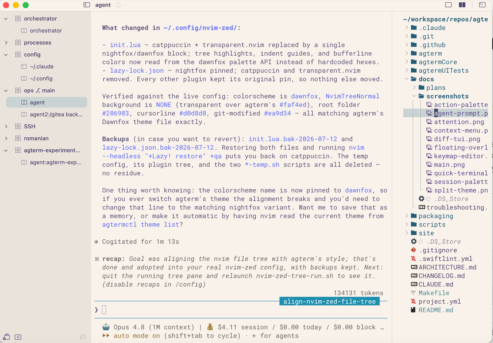
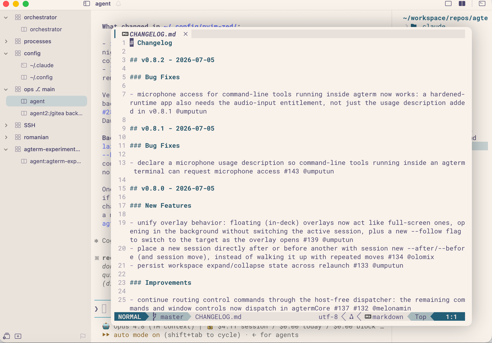
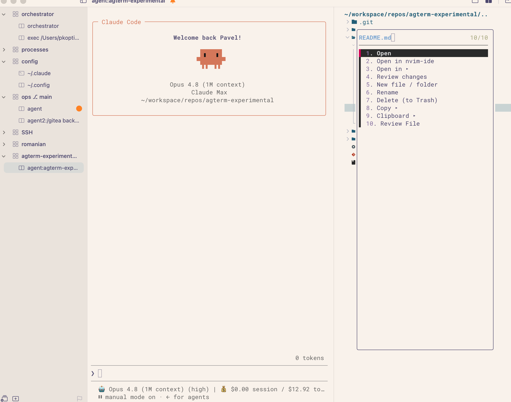

# agterm-tree

A file tree for [agterm](https://agterm.com), built entirely on its control API. No app changes, no
patched binary — nvim-tree in a split pane, `agtermctl` doing the rest.



The tree lives in the session's **right split**. Its background is transparent, so it *is* the terminal
background — there's no seam between the panes, just agterm's own divider.

## Why not just use yazi in an overlay?

Because an overlay is something you *summon*. This stays **visible next to the agent**.

When a coding agent is working, the files it's touching are right there. It keeps the mental picture
straight: the agent isn't operating in a vacuum, it's working on *these* files. Without that, the
session is a chat window that happens to touch a repo somewhere.

That's the whole reason this exists. If you don't run agents in your terminal, a TUI file manager in an
overlay is probably the better answer, and agterm already does that well.

## Opening files



Selecting a file doesn't open it *in the tree pane* — it opens in a 90% **agterm overlay**. Each open
replaces the last, so there's nothing to manage: no tabs, no window juggling. Close it and you're back
at the tree.

What opens depends on the file: nvim for code, a kitty-graphics viewer for images, glow or Typora for
markdown. Another key sends the file to a persistent tmux-backed editor instead, if you want to keep it
around.

## The context menu



`<leader>m` or right-click on any file or folder.

The menu is **defined in a YAML file**, not in Lua — so adding an entry is a few lines:

```yaml
  - name: Review changes
    isDir: false                  # files only
    run: overlay                  # in an agterm overlay, over this session
    cmd: revdiff --only $REL      # $REL, $ABS, $DIR… are substituted, shell-escaped
```

Entries can be filtered per node (`isDir`, `isFile`, `ext: [md]`), nested into submenus, and run either
a built-in tree action (rename, delete-to-Trash, copy path) or any shell command — detached, in an
overlay, or in a whole new agterm session. Edit the YAML, re-open the menu; no restart.

A **Search** submenu runs fzf-lua from the menu — find-file and grep, either across the project or
scoped to the folder you right-clicked (that second one has no keybinding; it's the thing the menu adds).
Picks open the way this tree opens everything else: in an overlay, never in the tree window.

Entries also hide themselves where they *can't* work: `needs: [glow]` drops an entry when the binary
isn't on PATH, and anything using `run: overlay`/`session` disappears where there's no `agtermctl`. So
the same YAML can ride along to a Linux box (over ssh, say) and simply shrink to the subset that runs
there, rather than offering things that fail when clicked.

Add `key: gd` to an entry and the menu label becomes `[gd] Review File` — a cosmetic hint at the tree
keybinding that does the same thing, so the menu doubles as a cheatsheet. Submenus open with a `..` row
that takes you back.

The menu in the screenshot has entries for reviewing a file in [revdiff](https://github.com/umputun/revdiff)
(annotations land on the clipboard, ready to paste to an agent), opening in Finder/Typora/glow, and
shelling into a directory.

## Install

**Ask your coding agent to do it.** [`AGENT_INSTRUCTION.md`](AGENT_INSTRUCTION.md) is written for exactly
that — it tells the agent what to check, what to ask you, and how to verify it worked.

Point Claude Code (or similar) at this directory and say:

> Set up agterm-tree from this repo, following AGENT_INSTRUCTION.md.

It'll check your prerequisites, ask before touching anything it shouldn't (an existing `nvim-zed`
config, a taken keybinding, your terminal theme), install the files, and verify the result.

You can of course do it by hand — the same file works as a checklist.

## Requirements

agterm with `agtermctl` on PATH · neovim ≥ 0.9 · `jq` · and **either** `ruby` (macOS system ruby is
fine — nothing to install) **or** `python3` + PyYAML, to parse the menu YAML.

Optional, per menu entry: `revdiff`, `glow`, Typora. Anything you don't have, delete that entry.

## Caveats

**This is my personal setup, lifted into a repo.** It's tuned to how I work — the keybinding is
`ctrl+b>z`, the colors assume agterm's Dawnfox theme, and some menu entries call scripts from my wider
setup that aren't bundled. All of that is documented and easy to change, but read before you copy.

The tree pane is a *file browser*, not an editor: no statusline, no tabs. Files open elsewhere. That's
deliberate.
