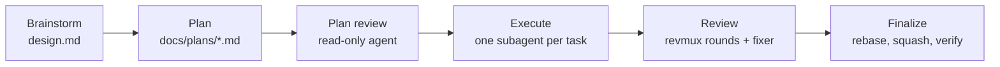
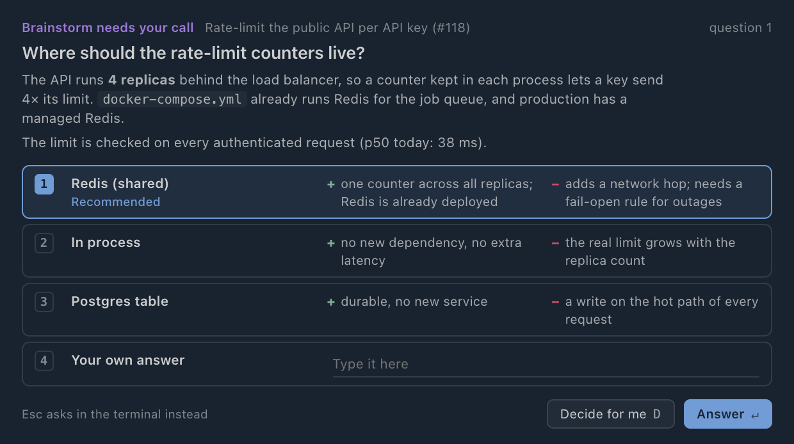
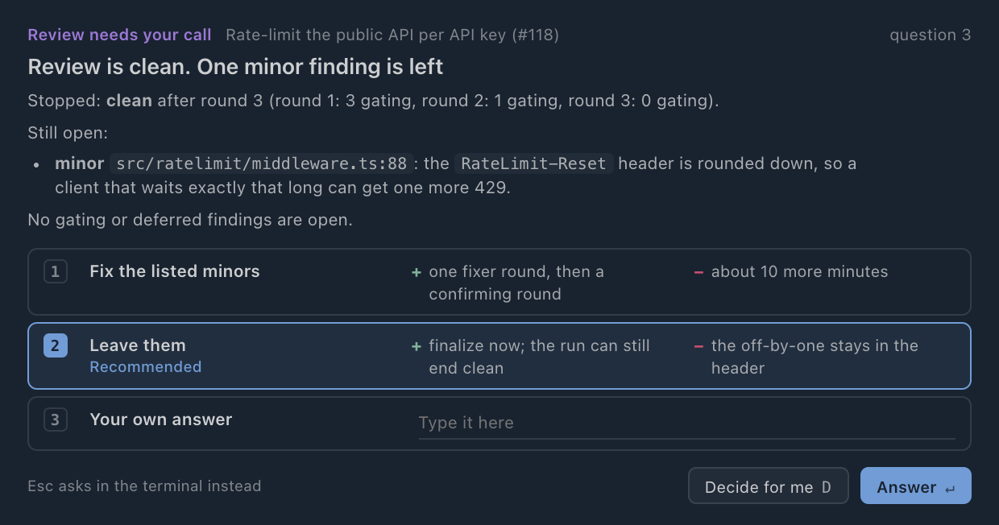
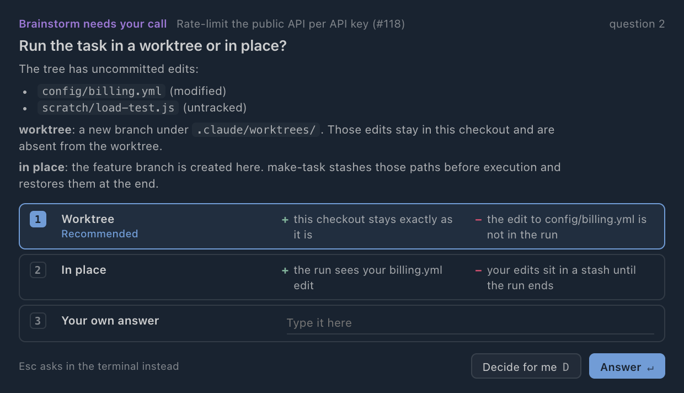

# make-task

One development task, from idea to a reviewed branch, in one Claude Code session.

```
/make-task [--profile=<name>] [--update] [task text]
```

It runs brainstorm, plan, plan review, task-by-task execution, a multi-agent review loop and finalize.
You answer a few questions at the start and come back to a branch with a final status on it.

---

## The problem

The pieces exist as separate skills: brainstorm, planning, plan execution, revmux review. Run them by
hand and you are the glue:

- you start each phase and carry its output into the next one
- each skill asks its own questions at its own time, so you stay at the keyboard for the whole run
- the review loop (review, fix, review again) is yours to drive and to stop
- after an auto-compact or a crash you work out where things were

make-task is the orchestrator for that chain. The session that runs it writes no code. It drives the
phases, hands the work to subagents and keeps a journal of every step.

---

## Five phases



| phase | who does the work | output |
|---|---|---|
| Brainstorm | the orchestrator, following the brainstorm companion | `design.md` |
| Plan | the orchestrator with the planning companion; a read-only `Plan` agent then reviews it | a plan in `docs/plans/` with `### Task N` sections and checkboxes |
| Execute | one `general-purpose` subagent per task, one at a time | commits on the feature branch, a progress log |
| Review | revmux (claude and codex reviewers in parallel), then a fixer subagent | review rounds, fix commits |
| Finalize | a finalizer subagent, then a stats subagent | rebased branch, final status, stats |

---

## What it looks like


On the left is the Claude session running make-task. On the right is the dashboard make-task opens in
an agterm split. This run is issue #64 of a browser extension, about 30 minutes in, executing the first
of five tasks.

---

## Reading the dashboard

- **Header.** Task title, repo, branch, worktree or in place, the profile and its autonomy level.
- **Artifact buttons.** Design, Plan, Progress log, Review, Stats, Changes. Each shows how long ago it
  changed and opens as a floating panel over the session. Changes runs `revdiff` from the commit where
  the task's work starts, so you can read the task's commits while it runs. A button stays grey until
  its artifact exists (Review and Stats in the screenshot).
- **Now strip.** What the orchestrator is doing right now, and the run's total clock (29m 33s).
- **Phase rail.** Each phase with its duration: Brainstorm 8m 28s, Plan 13m 28s. Execute lists the
  plan's tasks with checkbox progress (`0/6`) and a live timer on the running one.
- **Assumed for you, You decided.** Every choice the run made on its own, with its reason, and every
  answer you gave. Here it is 23 assumptions and 0 questions: under the `default` autonomy, brainstorm
  found nothing in this task that needed the user.
- **Timeline.** The last seven events, below what the screenshot shows.

The dashboard is an HTML page that reloads a `state.js` file every 1.5 s. `scripts/mt` writes that file,
and it is the only part of make-task that talks to agterm.

---

## Who gets asked what

Brainstorm sorts every question into three classes:

1. Trivial. The orchestrator decides and records an assumption.
2. A recommendation a reasonable engineer would accept. Also decided and recorded.
3. Needs your knowledge or taste. Asked, one question at a time.

The profile's autonomy level picks which classes reach you:

| autonomy | asked during brainstorm | design | gates |
|---|---|---|---|
| `autonomous` | nothing | written once | none |
| `default` | class 3 | written once | none |
| `interactive` | classes 2 and 3 | approved section by section | design, plan, each review round |

After brainstorm nothing is asked at any level, apart from the gates, the leftovers card at the end and
the error cards. Every other judgment call becomes an assumption with a reason, and the dashboard lists
all of them. Under `autonomous` the worktree and leftovers cards are answered from the profile's
`defaults`.

---

## Question cards

Inside agterm a question is a floating card over the session:

- 1 to 4 options, each with a pro and a con, one marked recommended
- a free-text answer
- **Decide for me** (`D`), which takes the recommended option and records it as an assumption



A card waits up to 9 minutes. If you dismiss it or it times out, the same question comes back as a
plain `AskUserQuestion` in the terminal. Outside agterm, or with `MT_NO_CARDS=1`, every question is an
`AskUserQuestion` from the start.

---

## Execute: one subagent per task

The plan is a checklist, and the loop works through it:

1. Find the first `### Task N` with an unchecked box.
2. Start one subagent with the task prompt and wait for it.
3. Re-read the plan. All boxes checked, go to the next task. Not checked, retry once with a fresh agent
   and the error appended. A second failure shows an error card (retry or stop).

Only the checkboxes count. The orchestrator ignores what the agent says it did, and it never fixes or
debugs code itself.

Every subagent gets the same rules appended to its prompt:

- ask the user nothing, take judgment calls from the project's CLAUDE.md, lint rules and conventions
- log each judgment call in the progress file as a `[decision]` or `[deviation]` line
- commit only the paths you changed, with an explicit pathspec, never `git add -A` or `git stash`
- never rewrite a commit from before the task started, never push

The `[decision]` and `[deviation]` lines end up in the final report.

---

## Review: the revmux loop

Each round:

1. revmux runs claude and codex reviewers in parallel over the task's commits.
2. `critical` and `major` findings gate the round. A finding outside the change's scope is recorded as
   not gating.
3. If gating findings are left, a fixer subagent fixes them and the next round starts.

The fixer gets three extra rules. Sweep the repo for the same construct, not only the reported line.
List every case the fix touches and write tests that tell them apart. Re-read the finding against the
fix before committing.

The loop stops when a round is clean, when the gating count stops dropping and a finding repeats, or
after five rounds. Whatever is still open goes to the leftovers card. Open majors can get one fixer
round and a confirming round with revmux's `final` profile, or stay, and then the run ends `not clean`.
Minors left on their own do not stop a run from ending `clean`.

---

## Review in progress


All five tasks are done. Round 1 found one critical and two major findings, a fixer subagent fixed
them, and round 2 is in revmux's verify stage with 3 of 4 reviewers finished. The Stats button stays
dashed until the run ends.

---

## The leftovers card



Round 3 came back clean with one minor finding open, so the run asks once more before finalize. With
open majors the options read "Fix the remaining majors" and "Leave them and finalize (run ends as not
clean)".

---

## Finalize and the final status

A finalizer subagent rebases onto `origin/<default>`, squashes the task's commits and runs the tests.
`mt review verify-final` then checks that HEAD holds exactly the reviewed content, replayed onto the new
base. A stats subagent reads the session logs and reports time, tokens and tool calls per task, fixer
and finalizer.

The run ends with one of five statuses:

| status | meaning |
|---|---|
| `clean` | no open findings, the last round reviewed the final content, rebase and tests ok |
| `not clean` | findings left open, a degraded last round, commits after the last round, or a failed rebase or test run |
| `review stale` | the finalize step changed what the review saw |
| `review skipped` | no review ran: the profile skips it, or revmux was unavailable |
| `stopped` | the run stopped on an error card |

`mt done` refuses `clean` unless the journal backs it, so the orchestrator cannot claim it on its own
word.

---

## A finished run


Three review rounds and 1h 20m in total. The user answered three cards, and the run took six decisions
on its own, each with its reason. After the run the artifact buttons show the time each artifact last
changed, and Stats is filled in. The timeline ends with the `verify-final` check and the final status.

---

## Your working tree stays yours

The last brainstorm card asks where the run happens:

- **worktree.** A new branch under `.claude/worktrees/`. Your checkout is not touched.
- **in place.** The feature branch is created in your checkout. Your uncommitted edits are stashed
  before execution and restored at the end.



In place, the stash is guarded at every step:

- the stash commit gets a private ref, `refs/make-task/<run_id>`, so `git gc` cannot drop it
- the restore applies by sha and never drops a stash entry, so a stash from another terminal is safe
- before applying, a trial merge checks for conflicts. On a conflict nothing is applied, and the report
  gives the command to run by hand
- every stop, errors included, gives the stash back

Started inside a linked worktree, the run skips the card and stays in place. That is the case in the
screenshot (`mode inplace` is the first assumption). make-task never pushes.

---

## Recovery after a compact or a crash

`scripts/mt` keeps a journal in the run's state directory
(`~/.local/state/make-task/<repo>-<slug>-<date>/`): the phase, a checkpoint per task and per fix,
every review round, every assumption and answer.

After an auto-compact, a crash or a long wait, the orchestrator runs `mt status`, re-reads the part of
`SKILL.md` for the printed phase and reconciles:

- a task checkpoint begun but not ended: re-read the plan's checkboxes, rerun the task if they are open
- a review round started without a result: check the revmux process and its report
- a card already answered: not asked again

---

## Profiles

A profile is a directory, `~/.config/make-task/profiles/<name>/`:

```
profile.md        autonomy, gates, defaults, the companion for each phase, ## <phase> sections
UPDATE.md         where each copy came from, its version, your own edits to the copies
companions/<id>/  the skill copies a run reads
upstream/<id>/    each source as last imported, the merge base for updates
data/<id>/        prompt and rule overrides
```

The `default` profile ships copies of Umputun's brainstorm and planning plugins and of the revmux skill,
with make-task's edits in them: no menus, no questions outside the three classes, a fixed review scope.
A run reads these copies, never the installed plugins, so a plugin update cannot change a run under you.

Your own instructions for a phase go into `profile.md` as `## brainstorm`, `## plan`, `## exec` or
`## review`. The order of precedence is make-task's own rules, then your section, then the companion's
text. Neither of the last two can relax a safety rule.

`/make-task --update` diffs the copies against their sources, merges upstream changes with your edits
and offers an interview to adjust the workflow.

---

## Requirements

Every run needs:

| tool | what uses it |
|---|---|
| Claude Code | runs the orchestrator and its subagents. The plan review uses the built-in `Plan` agent type; a Claude Code without it skips the plan review and records that |
| git | the branch, the commits, the stash and the review range. Outside a git repo make-task stops before it starts |
| [`uv`](https://docs.astral.sh/uv/) | runs `scripts/mt` (`uv run -q --script`) and installs its Python dependencies, `markdown-it-py` and `pyyaml` |

The review needs:

| tool | what uses it |
|---|---|
| [`revmux`](https://github.com/umputun/revmux) | runs the review rounds. Install with `brew install umputun/apps/revmux` |
| `jq` | the revmux preflight reads `revmux config` with it |
| `claude`, `codex` | the reviewers revmux starts, as its review profile names them |

When the preflight fails, a card during brainstorm offers to run without review or to stop. A run
without review ends `review skipped`, never `clean`.

The brainstorm, planning and revmux plugins are not needed. The profile carries its own copies of them.

Optional:

| tool | adds | without it |
|---|---|---|
| [agterm](https://agterm.com) | the dashboard, question cards, sidebar status | questions come as `AskUserQuestion` in the terminal; artifacts are still rendered in the state directory |
| [`revdiff`](https://github.com/umputun/revdiff) | the Changes button | the button stays disabled |
| the `view` skill at `~/.claude/skills/view/scripts/view.py`, or `MT_VIEW` | renders Design, Plan, Progress log, Review and Stats | those buttons stay disabled; a plugin-installed `view` is not found |
| `gh` | files an issue proposal from the `--update` interview | no proposal is filed |
| network access | `--update` checks a companion with a `git:` source | that source is not checked |

---

## Getting started

Link the skill into Claude Code:

```
ln -s <repo>/skills/make-task ~/.claude/skills/make-task
```

The first run installs the `default` profile and asks one question, the autonomy level:

```
/make-task add a --json flag to the export command
```

Other forms:

```
/make-task --profile=<name> <task>   run with another profile (a new name installs one)
/make-task --update                  check the profile's copies against their sources
```

---

## Read more

- [`skills/make-task/SKILL.md`](../skills/make-task/SKILL.md), the orchestrator's rulebook
- [`skills/make-task/README.md`](../skills/make-task/README.md), usage, requirements, what it changes on disk
- [`skills/make-task/references/profiles.md`](../skills/make-task/references/profiles.md), profile setup, updates and the interview
- [`skills/make-task/CLAUDE.md`](../skills/make-task/CLAUDE.md), notes and tests for editing the skill
