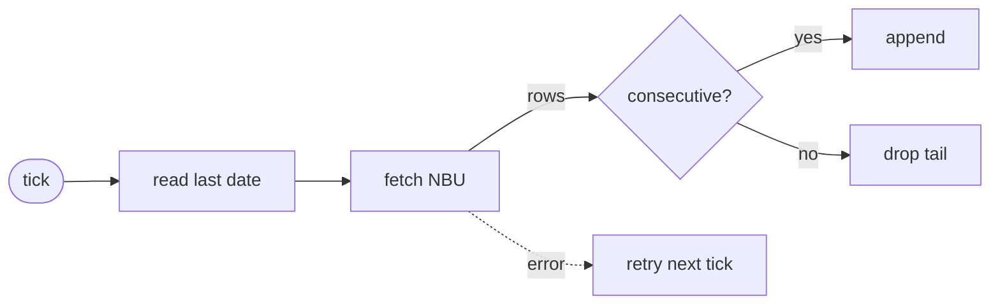
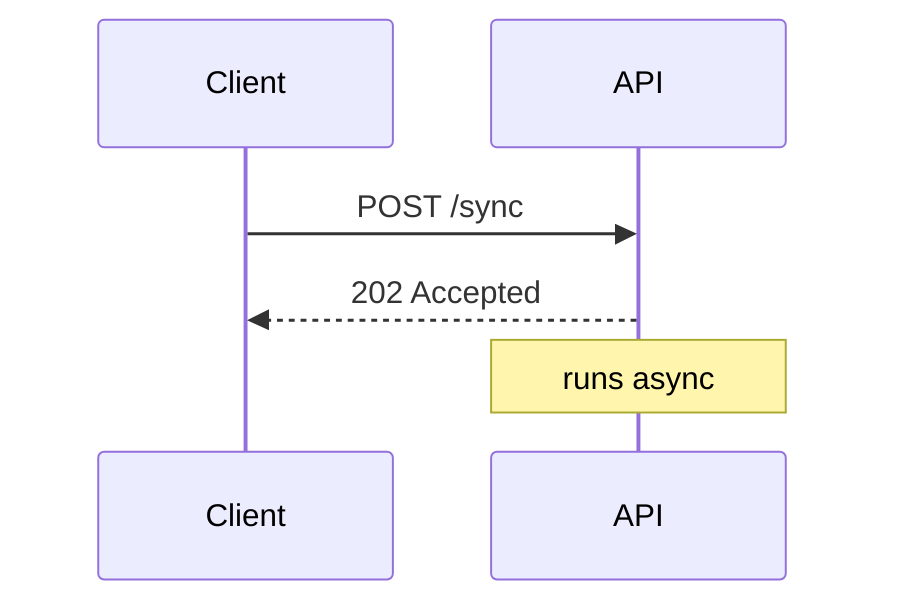

# Diagrams for `view`

Two tools, both themed from the terminal palette automatically. Never hard-code colors.

| Picture | Use |
|---------|-----|
| Boxes and arrows, call flow, decision tree, pipeline | Mermaid `flowchart` |
| Who calls whom over time, request/response | Mermaid `sequenceDiagram` |
| Lifecycle, modes, retries | Mermaid `stateDiagram-v2` |
| Schedule, phases | Mermaid `gantt` or `timeline` |
| Data model | Mermaid `erDiagram` / `classDiagram` |
| Anything with exact positions: rows of cells, a 24 h scale, memory layout, before/after | SVG kit (`<svg class="dg">`) |

Prefer Mermaid: layout is automatic. Draw SVG only when position itself carries meaning.

## Mermaid

Write a fenced ```mermaid block. Color a node with `:::accent` (new / focus), `:::ok`, `:::bad`,
`:::warn`, `:::muted` (dashed, inactive). No `classDef`, no `style` lines, no `%%{init}%%`.





Keep labels short (2–4 words). Use `LR` for pipelines, `TD` for trees. Quote labels that contain
punctuation: `A["load (cached)"]`. A label is markdown: one that starts with `1. ` or `- ` is a list
and renders as `Unsupported markdown: list`. Write `1\. find` or `step 1 — find`.

## SVG kit

Inline `<svg class="dg" viewBox="0 0 W H">` straight in the markdown, with a blank line before and
after it. Width scales to the page (max ~880 px), so design for W ≈ 700–860. The page supplies the
styles and arrowheads. Text is centered on its (x, y), horizontally and vertically.

| Class | On | Meaning |
|-------|----|---------|
| `box` | `rect` (add `rx="8"`) | neutral node |
| `box accent` / `ok` / `bad` / `warn` / `info` | `rect` | colored node |
| `box muted` | `rect` | dashed, inactive |
| `edge` | `path`/`line` | arrow (+ `accent`/`ok`/`bad`/`warn`/`info` color, `dash`, `both` = two heads) |
| `line` | `path`/`line` | plain rule, axis, tick (+ `dash`) |
| `t` / `s` | `text` | title (bold) / subtitle (small, dim) |
| `lbl` | `text` | label on top of a line (masks the line behind it) |
| `l` / `r` | `text` | left / right aligned instead of centered |
| `accent` / `ok` / `bad` / `warn` / `info` / `muted-text` | `text` | text color |
| `dot accent` … | `circle` | colored marker |

Row of cells (a sheet, a buffer, a queue):

```html
<svg class="dg" viewBox="0 0 720 120">
  <text class="s l" x="10" y="20">sheet</text>
  <rect class="box" x="80" y="5" width="90" height="30" rx="4"/><text x="125" y="20">09.10</text>
  <rect class="box" x="175" y="5" width="90" height="30" rx="4"/><text x="220" y="20">10.10</text>
  <text class="s l" x="10" y="70">NBU</text>
  <rect class="box ok" x="270" y="55" width="90" height="30" rx="4"/><text x="315" y="70">11.10</text>
  <rect class="box muted" x="365" y="55" width="90" height="30" rx="4"/><text class="muted-text" x="410" y="70">12.10</text>
  <rect class="box bad" x="460" y="55" width="90" height="30" rx="4"/><text x="505" y="70">13.10</text>
  <text class="s bad" x="505" y="105">dropped: gap before it</text>
</svg>
```

Time scale (ticks every 3 h on 0–24 h, x = 40 + h·27.5):

```html
<svg class="dg" viewBox="0 0 740 90">
  <text class="t" x="253" y="14">polling NBU every tick</text>
  <text class="s" x="583" y="14">idle until midnight</text>
  <rect class="box accent" x="40" y="26" width="426" height="24" rx="4"/>
  <rect class="box muted" x="466" y="26" width="234" height="24" rx="4"/>
  <line class="line" x1="40" y1="60" x2="700" y2="60"/>
  <g class="s"><text x="40" y="76">00:00</text><text x="205" y="76">06:00</text><text x="370" y="76">12:00</text><text x="535" y="76">18:00</text><text x="700" y="76">24:00</text></g>
</svg>
```

## Check before showing

- `view.py` exits with code 3 and prints `MERMAID ERROR: diagram N: …` when a Mermaid block fails.
  Fix it and run again.
- For hand-drawn SVG, look at it before showing the user:
  `view.py doc.md --shot /tmp/doc.png --shot-only`, then Read the PNG. Add `--shot-dark` for the dark
  palette. Check that labels do not overlap boxes or each other. The PNG is taller than the page: the
  empty space at the bottom is normal.
